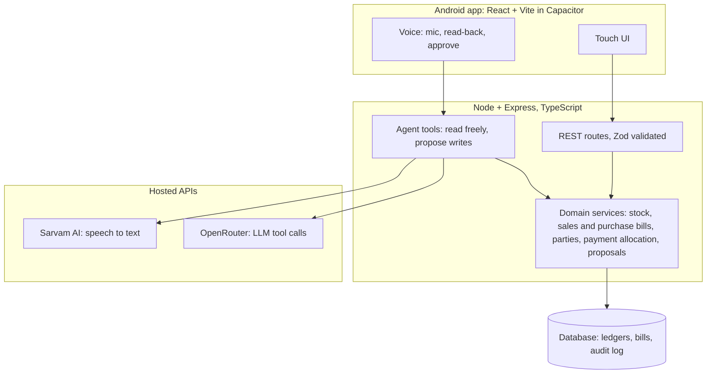
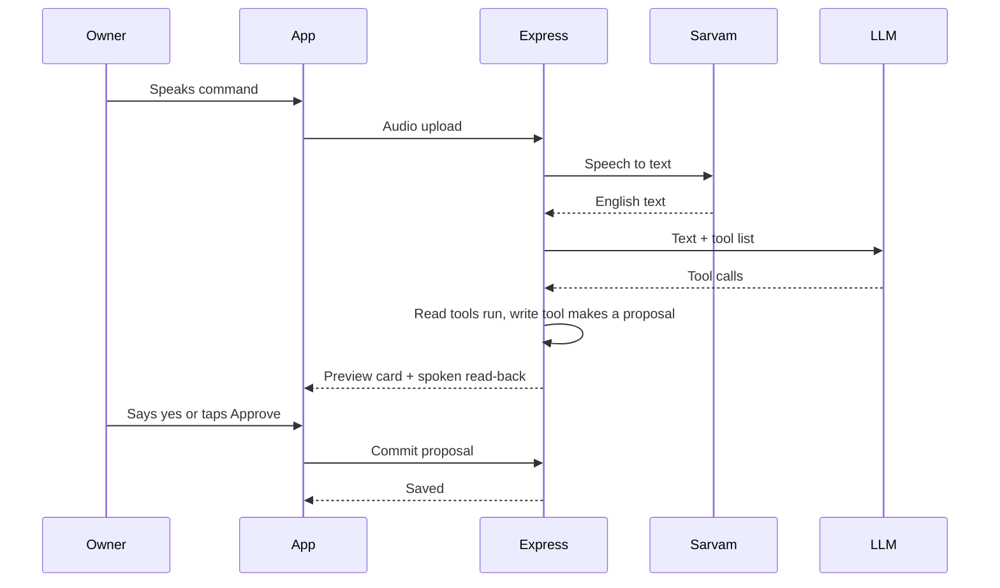

# VoiceStock: Architecture and Tech Stack

Part of [PRD.md](PRD.md). One Express server holds the domain services. The touch UI reaches them through REST routes and voice reaches them through agent tools, so both end in the same functions and the same rules.

## Diagram



## Stack

| Layer | Choice | Why |
| --- | --- | --- |
| Repo | npm workspaces: `apps/web`, `apps/api`, `packages/shared` | Shared types and schemas, one install, one CI |
| Frontend | React + TypeScript + Vite, Tailwind CSS | Chosen stack, fast to build |
| Android | Capacitor wrapper of the Vite build | One codebase gives a web link and an APK |
| Backend | Node + Express + TypeScript | Chosen stack |
| Validation | Zod | One schema serves REST validation and LLM tool definitions |
| Speech | Sarvam AI, English | Speech-to-text |
| LLM | OpenRouter, OpenAI-compatible API | Model switching without code changes |
| Database | Relational, Postgres-compatible schema | Supabase move later without a rewrite |

## Repository layout

```
voicestock/
  package.json            # npm workspaces
  apps/
    web/                  # React + Vite + Capacitor
    api/                  # Express server
  packages/
    shared/               # Zod schemas, types, tool definitions
  docs/                   # these .md files
```

## Key design rules

- One service layer. REST routes and agent tools are thin wrappers around the same functions in `apps/api/src/services`.
- The agent never touches the database directly. It cannot do anything a user cannot do by tapping.
- Read tools run immediately. Write tools return a proposal, and only `POST /proposals/:id/commit` saves it.
- Tools are defined once in `packages/shared` with Zod, then used for REST validation, the LLM tool list and the later MCP server.
- Stock and balances are sums over append-only ledgers, so a mistake is fixed with a reversing entry.
- Money is whole paise in the database and in code.

## Data model

| Table | Purpose |
| --- | --- |
| `items` | Name, unit, prices, reorder level |
| `stock_movements` | Append-only ledger; stock on hand is the sum |
| `parties` | Customers and suppliers |
| `bills`, `bill_lines` | Sales and purchase bills (kind field) with lines |
| `payments` | Money received or paid, with mode and date |
| `payment_allocations` | Which payment paid how much of which bill |
| `ledger_entries` | Credit and debt per party; balance is the sum |
| `proposals` | Pending voice or agent changes with expiry |
| `audit_log` | Who or what changed data, touch or voice |
| `providers` | OpenAI-compatible provider settings and active model |

## Voice pipeline



## Provider settings

The owner adds any OpenAI-compatible provider (name, base URL, API key, models) and switches the active model from settings. Keys are stored server-side and masked in the app.
