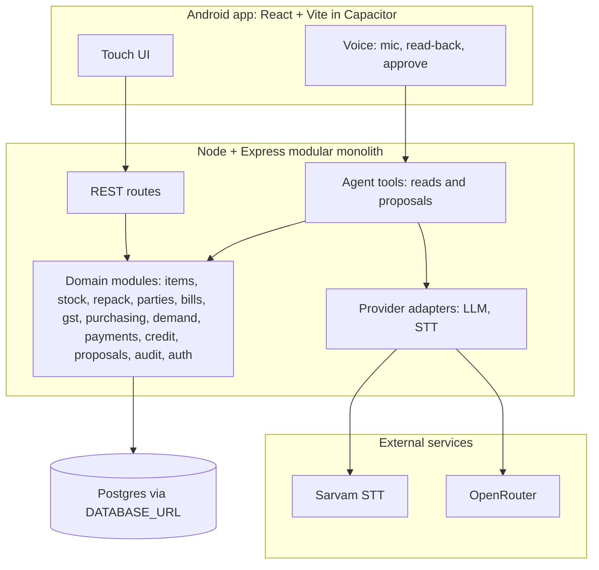

# Sauda: Architecture and Tech Stack

Part of [PRD_1.md](PRD_1.md). One Express deployable holds the domain modules. Touch reaches them through REST routes and voice reaches them through agent tools, so both end in the same public module functions.

## Diagram



## Modular monolith boundaries

| Module | Responsibility |
| --- | --- |
| `auth` | Owner PIN, device tokens and revocation |
| `items` | Items, units, pack size, prices, HSN and GST rate |
| `stock` | Append-only batch movements, FIFO layers and stock queries |
| `repack` | Consuming base stock, producing packs, wastage and reversal |
| `parties` | Customer/supplier profiles and contact import/export |
| `bills` | Sales and purchase bills and bill lines |
| `gst` | Tax calculation, CGST/SGST split and GST summaries |
| `payments` | Payment records and reversals |
| `credit` | Receivable, payable and advance ledgers |
| `purchasing` | Budgets, purchase drafts, purchase orders and goods receipt |
| `demand` | Velocity, festival notes, dead-stock and expiry signals |
| `proposals` | Preview, approval, expiry and one-time commit |
| `audit` | Actor, source, operation and before/after history |
| `agent` | Tool definitions and the model loop |
| `voice` | Microphone gateway and Sarvam transcription |

### The one rule that keeps it modular

Each module has exactly one public door:

```text
apps/api/src/modules/<name>/
  public.ts        <- the only file another module may import
  <name>-service.ts
  ...internal files
```

- Outside code imports `modules/<name>/public.ts` only.
- Importing anything else inside a module fails `npm run boundaries`, in CI and locally.
- `public.ts` exports functions and DTOs, never Prisma types.
- The Prisma client may be imported only inside a module or `apps/api/src/db.ts`.
- Modules may call each other only through `public.ts`.
- `packages/shared` stays a leaf: contracts never import from `apps/`.
- `apps/api/src/providers/` is the only vendor integration layer. Domain modules receive vendor-neutral LLM and STT interfaces.
- OpenAI-compatible chat calls and Sarvam-compatible multipart transcription are assembled from environment variables.
- Provider API keys never enter shared DTOs, web code or responses.
- Missing provider credentials fail environment validation outside test mode; tests inject mock fetch implementations.

Two checks enforce this, both running in `npm run check` and in the `verify` CI job:

| Command | What it proves |
| --- | --- |
| `npm run boundaries:deps` | dependency-cruiser: no import cycles, `shared` is a leaf, the web app never imports server or Prisma code |
| `npm run boundaries:code` | `tools/module-boundaries.ts`: parses the real import graph with the TypeScript compiler, so deep imports are rejected while same-module imports and cross-module `public.ts` calls still pass |

The code check compares the importing file with the target, which regex-only rules cannot do. Its
own tests in `tools/module-boundaries.test.ts` build small fixture trees and assert that a deep
import fails while the public door passes, so the gate cannot rot silently.

## Repository layout

```text
sauda/
  apps/
    web/                  React, Vite, Tailwind and Capacitor
    api/
      src/
        modules/          domain modules, each with public.ts
        routes/           thin Express wrappers
        agent/            tool registry and model loop
        providers/        LLM, STT and database adapters
        db/               Prisma client
      prisma/
  packages/
    shared/               Zod contracts, DTOs and tool definitions
  deploy/                 Oracle configuration, reverse proxy and services
  docs/
```

## Provider adapters

Everything external is resolved from environment at startup:

| Concern | Variables | Adapter |
| --- | --- | --- |
| Database | `DATABASE_URL` | `providers/db.ts` |
| LLM | `LLM_BASE_URL`, `LLM_API_KEY`, `LLM_MODEL` | `providers/llm.ts` |
| Speech | `STT_BASE_URL`, `STT_API_KEY`, `STT_MODEL`, `STT_LANGUAGES` | `providers/stt.ts` |
| Payments | Reserved, not in V1 | `providers/payments.ts` seam |

Changing a provider changes environment, not module code.

## Key rules

- REST routes and agent tools are thin wrappers around the same module public functions.
- Agent tools never touch the database.
- Read tools run immediately; write tools create proposals.
- Only `POST /proposals/:id/commit` commits.
- Stock and balances are sums over append-only ledgers.
- Money is stored and calculated in whole paise.
- Stock value and cost of goods are FIFO; summaries adjust across batches on hand.
- Expiry belongs to a batch, never to an item as a whole.
- Tax is computed per line and split CGST/SGST only.
- Repacking moves cost from consumed batches into produced pack batches and records wastage.
- Purchases are two-step: order, then receipt; only receipt changes stock and payables.
- Credit warnings are shown, never applied automatically.
- Every write is audited with its source, touch or voice.

## Authentication

- Owner sets a six-digit PIN on first run.
- The server issues a device token bound to that device.
- The app stores the token in secure storage; the PIN unlocks it locally.
- Tokens can be revoked server-side.
- REST and agent calls require the token.

## Deployment for the demo

- Oracle instance, 2 GB RAM, bare metal first.
- Node API behind Caddy or Nginx with HTTPS.
- Postgres on the same instance, reached through `DATABASE_URL`.
- Prisma migrations run as a release step.
- Containers are added after the demo; the module layout does not change.
- Voice and LLM calls stay server-side so keys never reach the APK.
