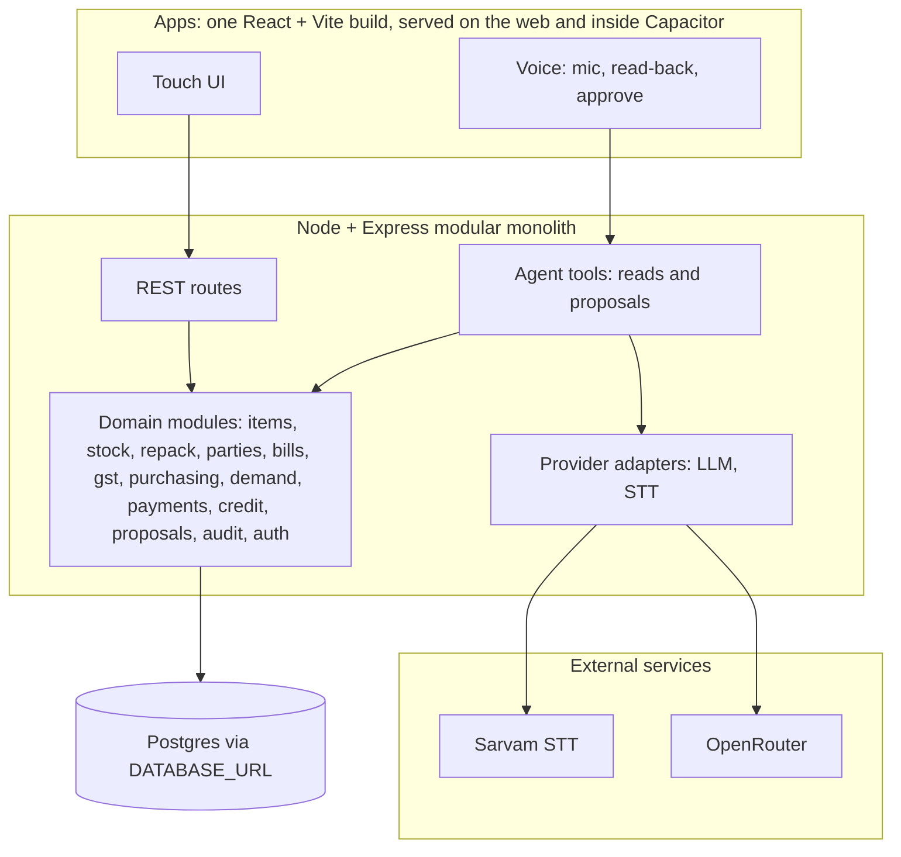

# Sauda: Architecture and Tech Stack

Part of [PRD_1.md](PRD_1.md). One Express deployable holds the domain modules. Touch reaches them through REST routes and voice reaches them through agent tools, so both end in the same public module functions.

## Diagram



## Modular monolith boundaries

| Module | Responsibility |
| --- | --- |
| `auth` | Shop accounts, salted password hashing, device tokens and revocation |
| `items` | Items, units, pack size, prices, HSN and GST rate |
| `stock` | Append-only batch movements, FIFO layers and stock queries |
| `parties` | Customer and supplier profiles, balances derived from bills |
| `orders` | Customer and supplier orders, fulfilment and the stock effect |
| `bills` | Bills, payments, derived status, reopening and recalculation |
| `audit` | Actor, source, operation and before/after history |
| `repack` | Consuming base stock, producing packs, wastage and reversal |
| `gst` | Tax calculation, CGST/SGST split and GST summaries |
| `payments` | Payment records and reversals |
| `credit` | Receivable, payable and advance ledgers |
| `purchasing` | Budgets, purchase drafts, purchase orders and goods receipt |
| `demand` | Velocity, festival notes, dead-stock and expiry signals |
| `proposals` | Preview, approval, expiry and one-time commit |
| `agent` | Tool definitions and the model loop |
| `voice` | Microphone gateway and Sarvam transcription |

### The one rule that keeps it modular

Each module has exactly one public door:

```text
apps/api/src/modules/<name>/
  public.ts        <- the only file another module may import
  <name>-service.ts
  ...internal files
```

- Outside code imports `modules/<name>/public.ts` only.
- Importing anything else inside a module fails `npm run boundaries`, in CI and locally.
- `public.ts` exports functions and DTOs, never Prisma types.
- The Prisma client may be imported only inside a module or `apps/api/src/db.ts`.
- Modules may call each other only through `public.ts`.
- `packages/shared` stays a leaf: contracts never import from `apps/`.
- `apps/api/src/providers/` is the only vendor integration layer. Domain modules receive vendor-neutral LLM and STT interfaces.
- OpenAI-compatible chat calls and Sarvam-compatible multipart transcription are assembled from environment variables.
- Provider API keys never enter shared DTOs, web code or responses.
- Missing provider credentials fail environment validation in production; in development and test they fail when the provider is first used, so voice-only runs and tests need no LLM key.

Two checks enforce this, both running in `npm run check` and in the `verify` CI job:

| Command | What it proves |
| --- | --- |
| `npm run boundaries:deps` | dependency-cruiser: no import cycles, `shared` is a leaf, the web app never imports server or Prisma code |
| `npm run boundaries:code` | `tools/module-boundaries.ts`: parses the real import graph with the TypeScript compiler, so deep imports are rejected while same-module imports and cross-module `public.ts` calls still pass |

The code check compares the importing file with the target, which regex-only rules cannot do. Its
own tests in `tools/module-boundaries.test.ts` build small fixture trees and assert that a deep
import fails while the public door passes, so the gate cannot rot silently.

## Repository layout

```text
sauda/
  apps/
    web/                  React, Vite, Tailwind and Capacitor
    api/
      src/
        modules/          domain modules, each with public.ts
        routes/           thin Express wrappers
        middleware/       auth, CORS, actor context and error mapping
        providers/        LLM, STT and database adapters
        express-app.ts    app factory shared by Vercel and local runs
        local-server.ts   the listener used in development
        db.ts             the one Prisma client
      prisma/             schema and migrations
  packages/
    shared/               Zod contracts, DTOs and tool definitions
  deploy/                 Oracle configuration, reverse proxy and services
  docs/
```

## Provider adapters

Everything external is resolved from environment at startup:

| Concern | Variables | Adapter |
| --- | --- | --- |
| Database | `DATABASE_URL` | `providers/db.ts` |
| LLM | `LLM_BASE_URL`, `LLM_API_KEY`, `LLM_MODEL` | `providers/llm.ts` |
| Speech | `STT_BASE_URL`, `SARVAM_API_KEY` (or `STT_API_KEY`), `STT_MODEL`, `STT_MODE` | `providers/stt.ts` |
| Payments | Reserved, not in V1 | `providers/payments.ts` seam |

Changing a provider changes environment, not module code.

## Key rules

- REST routes and agent tools are thin wrappers around the same module public functions.
- Agent tools never touch the database.
- Read tools run immediately; write tools create proposals.
- Only `POST /proposals/:id/commit` commits.
- Stock and balances are sums over append-only ledgers.
- A batch's `remaining` is a FIFO layer, not a stock balance; on-hand is summed from movements.
- Money is stored and calculated in whole paise.
- Stock value and cost of goods are FIFO; summaries adjust across batches on hand.
- Expiry belongs to a batch, never to an item as a whole.
- Tax is computed per line and split CGST/SGST only.
- Repacking moves cost from consumed batches into produced pack batches and records wastage.
- Purchases are two-step: order, then receipt; only receipt changes stock and payables.
- Credit warnings are shown, never applied automatically.
- Every write is audited with its source, touch or voice.

## Authentication

- A shop signs up with a shop name and an alphanumeric password; the pair identifies the shop and its data.
- Passwords are hashed with scrypt and a per-shop random salt. The plain password is never stored or logged.
- Shop names are matched on a trimmed, lowercased key so case and padding do not split one shop into two.
- The server issues a device token on sign-up or sign-in.
- The app stores the token in secure storage and sends it with every REST call.
- Tokens can be revoked server-side.
- Five failed sign-ins lock that shop for fifteen minutes; a wrong shop name and a wrong password return the same message.

## HTTP surface

Every route family answers failures as `{ code, message }`, with `retryAfterSeconds` added when a
lockout is active.

| Method | Path | Auth | Purpose |
| --- | --- | --- | --- |
| `GET` | `/health` | none | Liveness probe |
| `POST` | `/auth/signup` | none | Create a shop and its owner, return a device token |
| `POST` | `/auth/signin` | none | Exchange shop name and password for a device token |
| `GET` | `/auth/me` | token | The signed-in shop and owner |
| `POST` | `/auth/logout` | token | Revoke this device token |
| `POST` | `/voice/transcribe` | token | Sarvam speech-to-text, English output |
| `GET` | `/items` | token | Items with stock on hand |
| `GET` | `/items/:itemId` | token | One item with stock on hand |
| `POST` | `/items` | token | Create an item |
| `PATCH` | `/items/:itemId` | token | Change name, unit, prices, reorder level, GST or HSN |
| `DELETE` | `/items/:itemId` | token | Archive an item; history stays |
| `GET` | `/stock/summary` | token | On-hand quantity per item |
| `GET` | `/stock/movements?itemId=` | token | Recent movements for one item |
| `POST` | `/stock/receive` | token | Receive a batch, optionally with cost and expiry |
| `POST` | `/stock/adjust` | token | Signed adjustment with a reason |
| `GET` | `/parties` | token | Parties with receivable and payable balances |
| `GET` | `/parties/:partyId` | token | One party with its bills and balances |
| `POST` | `/parties` | token | Create a customer or supplier |
| `PATCH` | `/parties/:partyId` | token | Change name, phone, address, notes or type |
| `DELETE` | `/parties/:partyId` | token | Archive a party; history stays |
| `GET` | `/orders` | token | Orders filtered by type, status, party or search |
| `GET` | `/orders/:orderId` | token | One order with its lines |
| `POST` | `/orders` | token | Create an order, optionally fulfilling it in the same call |
| `PATCH` | `/orders/:orderId` | token | Edit an order; needs `version` |
| `POST` | `/orders/:orderId/fulfil` | token | Fulfil a pending order and create its bill |
| `DELETE` | `/orders/:orderId` | token | Delete an order, its bill and reverse stock |
| `GET` | `/bills` | token | Bills filtered by status, type, party or search |
| `GET` | `/bills/:billId` | token | One bill with payments and its order |
| `POST` | `/bills/:billId/payments` | token | Record a payment |
| `POST` | `/bills/:billId/reopen` | token | Reopen a closed bill |
| `PATCH` | `/payments/:paymentId` | token | Edit a payment; needs `version` |
| `DELETE` | `/payments/:paymentId` | token | Delete a payment |
| `GET` | `/dashboard/summary` | token | Today's sales, purchases, outstanding and bill counts |
| `GET` | `/audit` | token | History entries, filterable by entity |

Items and stock are separate modules. The items route is the composition layer that adds
`stockOnHand` to each item, so neither module imports the other's internals.

The same composition rule holds for parties, orders and bills: the route adds the party name
and item names, so `parties`, `orders` and `bills` never import each other's internals. The
`orders` module calls `bills` and `stock` through their `public.ts` doors only.

Bill status is derived, never stored by hand. `billStatus(total, paid)` in `packages/shared`
is the single source: `unpaid` at zero, `partial` below the total, `paid` at or above it.
`closed` follows `status === 'paid'`. Reopening clears `closed` without touching the status,
so the next payment or edit recalculates it.

## Deployment for the demo

Two Vercel projects deploy from the `main` branch of the GitHub mirror, plus Supabase for
Postgres.

| Piece | Project | URL | Notes |
| --- | --- | --- | --- |
| API | `sauda` | `https://api.sauda.thedeploymentlab.app` | Root entrypoint `app.ts`, Express preset |
| Web | `sauda-dash` | `https://dash.sauda.thedeploymentlab.app` | Vite preset, root directory `apps/web` |
| Database | Supabase | pooler host, port 5432 | Prisma migrations run before a release |

- The web build reads `VITE_API_BASE_URL` from the environment (Vercel project variable, with
  `apps/web/.env.production` as the committed fallback), so the same source serves the web app
  and the APK without hardcoded hosts.
- `apps/web/vercel.json` sets the build and install commands, the SPA rewrite, and the security
  headers. Vercel's project settings pin the root directory to `apps/web` and enable source
  files outside the root directory so the workspace packages resolve.
- CORS on the API allows the dash origin, the Vercel production alias, and the Capacitor
  origins (`https://localhost`, `capacitor://localhost`).
- The API sends `x-content-type-options`, `x-frame-options`, a deny-all
  `content-security-policy`, `permissions-policy`, `cross-origin-opener-policy`,
  `cross-origin-resource-policy` and HSTS on every response; `x-powered-by` is disabled.
- Prisma migrations run as a release step.
- Voice and LLM calls stay server-side so keys never reach the APK or the web bundle.

## Security scanning in CI

The pipeline is split by concern: `.gitlab/ci/quality.yml` (lint, types, boundaries, tests,
build), `.gitlab/ci/security.yml` (Semgrep SAST and secret detection),
`.gitlab/ci/build.yml` (APK artifact named `sauda`) and `.gitlab/ci/dast.yml` (OWASP ZAP).

DAST runs on the default branch only, because it scans the deployed apps.

| Job | Target | Report |
| --- | --- | --- |
| `zap-web` | `DAST_WEB_URL` (defaults to the Vercel production URL) | `dast-reports/zap-web.json` |
| `zap-api` | `DAST_API_URL/health` | `dast-reports/zap-api.json` |

`tools/dast/zap_gate.py` turns ZAP's JSON report into a pass/fail gate. `.zap/rules.json` holds
the accepted risk threshold (Medium and High fail) and an `allow` map from ZAP plugin id to a
written reason. An alert is only suppressed when its id appears there with a reason, so every
exception is a reviewed decision in version control rather than a silent ignore. Both reports
are always uploaded as artifacts, so a failing scan can be inspected without re-running it.
