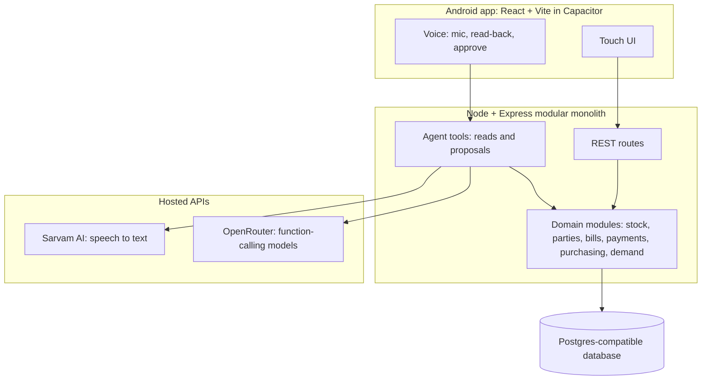

# Sauda: Architecture and Tech Stack

Part of [PRD_1.md](PRD_1.md). One Express server holds the domain services. The touch UI reaches them through REST routes and voice reaches them through agent tools, so both end in the same functions and rules.

## Diagram



## Modular monolith boundaries

Sauda uses one deployable server, but domain modules have explicit boundaries:

| Module | Responsibility |
| --- | --- |
| `items` | Item definitions, units, prices and reorder settings |
| `stock` | Append-only stock movements and stock calculations |
| `parties` | Customer/supplier profiles and contact import/export |
| `bills` | Sales and purchase bills and bill lines |
| `payments` | Payment records and reversals |
| `credit` | Receivable, payable and advance ledgers |
| `purchasing` | Cash budgets, reorder suggestions and purchase drafts |
| `demand` | Sales velocity, festival notes, expiry and dead-stock signals |
| `proposals` | Preview, approval, expiry and one-time commit |
| `audit` | Actor, source, operation and before/after history |
| `agent` | Shared read/write tool definitions and model loop |
| `voice` | Microphone gateway and Sarvam transcription |

A module may expose an explicit service API to another module. It may not reach another module's database tables directly.

## Repository layout

```text
sauda/
  apps/
    web/                  React, Vite, Tailwind and Capacitor
    api/                  Express modular monolith
  packages/
    shared/               Zod contracts, types and tool definitions
  docs/
```

## Key rules

- REST and agent tools are thin wrappers around the same domain services.
- Agent tools never have direct database access.
- Read tools run immediately; write tools create proposals.
- Only `POST /proposals/:id/commit` commits a proposal.
- Stock and balances are sums over append-only ledgers.
- Money is stored and calculated in whole paise.
- Purchasing proposals explain the evidence used and require owner approval.
- MCP is added after function calling is stable; it is not a separate implementation layer.
