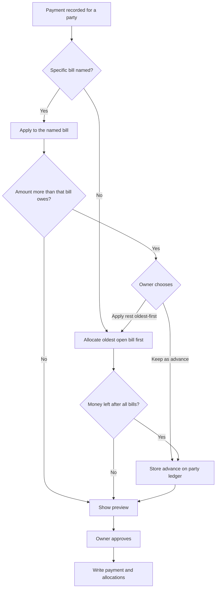

# VoiceStock: Payment Allocation Rules

Part of [PRD.md](PRD.md). A partial payment is applied to the party's total credit, oldest bill first, unless the owner picks a specific bill.

These rules apply in both directions:

- **Customer pays the shop:** the payment settles sales bills (receivable).
- **Shop pays a supplier:** the payment settles purchase bills (payable).

## Rules

1. **Default is oldest-first (FIFO).** A payment is allocated to the party's open bills of the matching kind, in order of bill date, then bill number. Each bill is cleared fully before the next is touched. The last bill touched may be left partly paid.
2. **Owner can choose a specific bill.** If the payment names a bill, the amount goes to that bill first. The owner can also split one payment across several chosen bills.
3. **Overflow asks, never guesses.** If the payment is larger than the chosen bill's outstanding amount, the preview asks: apply the rest oldest-first, or keep it as an advance.
4. **Overpayment becomes an advance.** Money above the total owed is stored as an unallocated advance on the party ledger and offered against the next bill.
5. **Paid at billing time.** The "paid now" amount on a new bill (sales or purchase) is allocated to that bill itself. It is not spread to older bills.
6. **Opening balances count.** Old udhaar or supplier dues entered when the shop starts using the app become dated opening-balance entries, so oldest-first works across them.
7. **Returns and credit notes** reduce the outstanding amount of the bill they refer to, using the same allocation records.
8. **Reversal is exact.** Cancelling a payment reverses its allocations, and every bill it touched returns to its earlier outstanding amount.
9. **Everything is previewed.** The owner sees which bills the payment will clear or reduce before approving, by touch or by voice.
10. **Receivable and payable stay separate.** A payment from a party who is both customer and supplier only touches the kind of bill the owner chose.

## Allocation flow

## Worked example

Ramesh has three open bills totalling Rs 4,500 and pays Rs 2,000.

| Bill | Date | Amount (Rs) | Oldest-first result | Owner picks bill 112, rest to advance |
| --- | --- | --- | --- | --- |
| 101 | 12 Nov | 1,500 | Cleared, Rs 1,500 applied | Untouched, Rs 1,500 due |
| 108 | 15 Nov | 2,000 | Rs 500 applied, Rs 1,500 due | Untouched, Rs 2,000 due |
| 112 | 18 Nov | 1,000 | Untouched, Rs 1,000 due | Cleared, Rs 1,000 applied |
| Advance | | | None | Rs 1,000 held on Ramesh's account |

After the oldest-first payment, Ramesh owes Rs 2,500. In the second case he owes Rs 3,500 on bills with a Rs 1,000 advance, so his net balance is also Rs 2,500.

## Supplier example

The shop owes Sharma Traders Rs 8,000 across two purchase bills: P-31 (Rs 3,000, 10 Nov) and P-35 (Rs 5,000, 17 Nov). The owner says "Paid Sharma 4,000". Oldest-first clears P-31 and applies Rs 1,000 to P-35, leaving Rs 4,000 owed.

## Data behind it

| Table | Role |
| --- | --- |
| `payments` | One row per payment: party, direction (received or paid), amount, mode, date |
| `payment_allocations` | Links a payment to a bill with the amount applied (payment, bill, amount) |
| `bills` | Sales or purchase bills; outstanding = total minus sum of allocations and returns |
| `ledger_entries` | Per-party credit and debt; balance is the sum of entries |

An advance is a `payment_allocations` row with no bill, so it can be applied later without editing the payment.

## Edge cases to test

- Payment exactly equal to the total owed clears every bill.
- Payment smaller than the oldest bill leaves it partly paid and touches nothing else.
- Two bills on the same date are ordered by bill number.
- Cancelling a payment that was split across three bills restores all three.
- A named bill that is already fully paid is refused with a clear message.
- A party with only an advance and a new bill offers to apply the advance.
