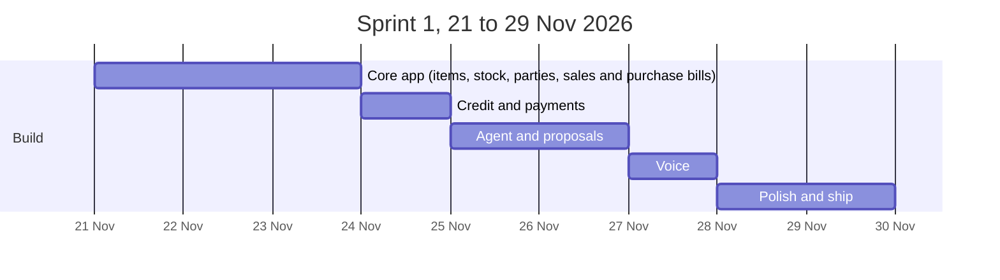

# Sauda: Sprint 1 Plan

Part of [PRD.md](PRD.md). Sprint 1 runs 21 to 29 Nov 2026 (9 days). Sprint review and demo on 29 Nov.

## Sprint goal

A working Android app where an owner can manage stock, sales bills, purchase bills, credit and payments by touch, and do the same by voice with a preview and approval step.

## Phases

| Days | Phase | Scope |
| --- | --- | --- |
| 21 to 23 Nov | Core app | Monorepo setup, schema, services and REST for items, stock, parties, sales bills and purchase bills. Screens for stock, new sales bill, new purchase bill and party ledger |
| 24 Nov | Credit and payments | Receivable and payable ledgers, payments in both directions, allocation (oldest-first and specific bill), advances, reversals |
| 25 to 26 Nov | Agent and proposals | Zod tool registry, proposal and approve flow, LLM agent loop with a text box first |
| 27 Nov | Voice | Mic recording, Sarvam speech-to-text, spoken read-back, voice approve |
| 28 to 29 Nov | Polish and ship | Provider settings, Capacitor APK, demo script, bug fixes, sprint review |

## Backlog by priority

### Must have

- [ ] Monorepo with `apps/web`, `apps/api`, `packages/shared`
- [ ] Items and stock ledger
- [ ] Parties (customers and suppliers)
- [ ] Sales bills with paid, partly paid and credit modes
- [ ] Purchase bills with paid, partly paid and credit modes
- [ ] Party ledger with receivable and payable
- [ ] Payments with oldest-first and specific-bill allocation
- [ ] Tool registry and proposal and approve flow
- [ ] Text agent, then voice with read-back
- [ ] Android APK via Capacitor

### Should have

- [ ] Provider settings and model switch
- [ ] Low-stock and overdue reports
- [ ] Reversal of bills and payments

### Later

- [ ] MCP server wrapping the tools
- [ ] Offline writes
- [ ] Barcode scanning and bill printing
- [ ] Other languages

## Definition of done

- Works by touch on a real Android phone.
- Each write by voice shows a preview and needs approval.
- Payment allocation passes the edge cases in [payment-allocation.md](payment-allocation.md).
- Audit log records the source (touch or voice) for every change.

## If time runs short

Cut in this order: reports, provider settings UI (use a config file), voice read-back polish. Do not cut the approval step or the allocation rules.
